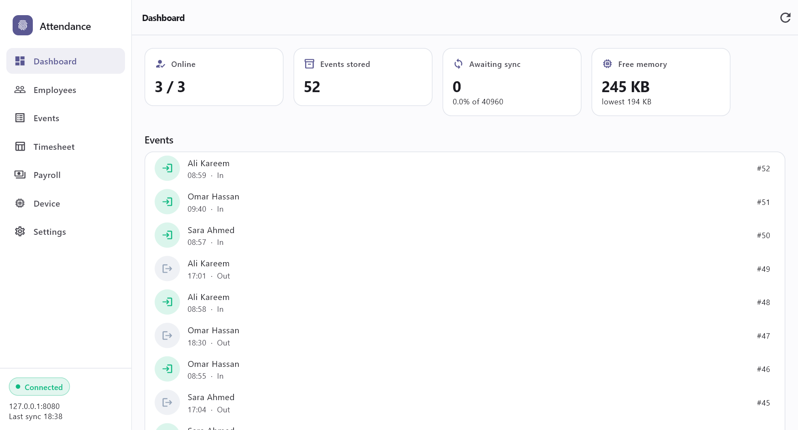
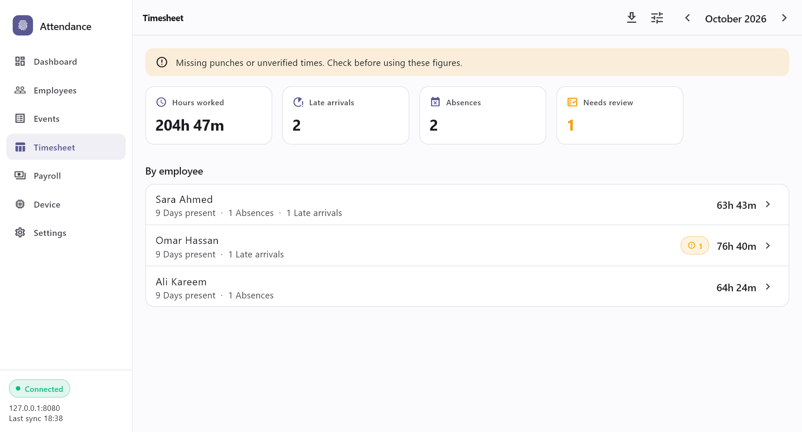
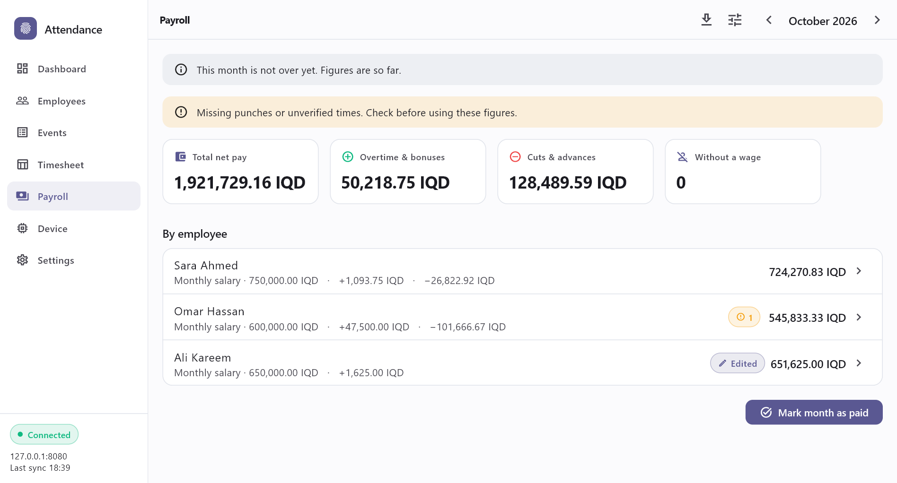
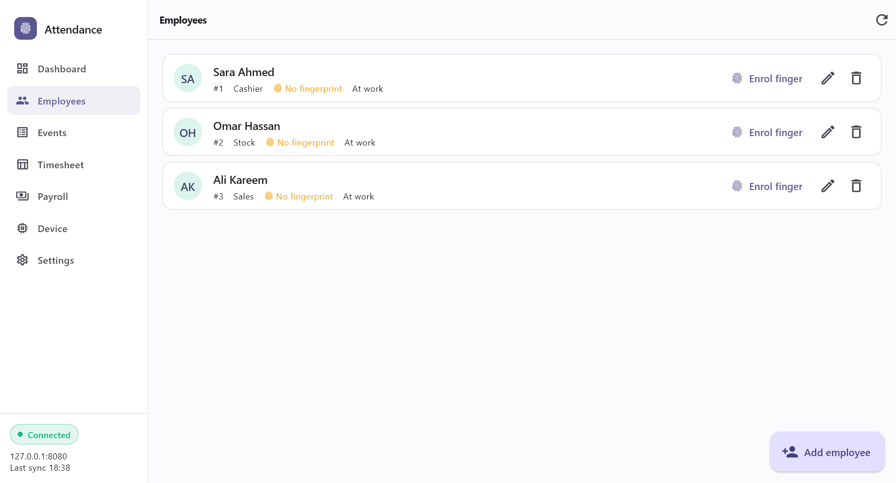

# Fingerprint Attendance

A complete check-in / check-out system for a small business (10–50 staff):
an **ESP32 fingerprint terminal** at the door and a **Windows admin app** for
the manager, with timesheets, payroll and Telegram alerts. Arabic and English
throughout, including right-to-left layout.



## Features

**Terminal (ESP32-C3 + FPM12 sensor + OLED)**
- Fingerprint check-in / check-out with an on-screen greeting (Arabic names
  rendered on the PC and shown as bitmaps)
- Stores up to 40,960 punches in flash, so it keeps working with the PC off
- Ethernet (ENC28J60 or W5500) with a Wi-Fi fallback, DHCP with a static
  fallback, and a network watchdog
- Sends Telegram alerts by itself: every punch, late arrivals, a daily summary
- Optional touch button to switch between IN and OUT mode
- Small HTTP API with token auth ([docs/protocol.md](docs/protocol.md))

**Admin app (Flutter, Windows)**
- Finds the terminal on the network automatically
- Employees and fingerprint enrolment, punches with manual corrections
  (every edit is audited)
- Shifts, timesheets with late / early / overtime / absence, .xlsx export
- Payroll: monthly, daily or hourly wages, overtime pay, late and absence
  cuts, bonuses and advances, "mark as paid" snapshots, payslip export
- Telegram and Wi-Fi setup for the terminal, app password, reset button,
  dark mode

| Timesheet | Payroll |
|---|---|
|  |  |
| **Employees** | **Payslip** |
|  |  |

## User guide

- [English (PDF)](docs/User-Guide-EN.pdf)
- [العربية (PDF)](docs/User-Guide-AR.pdf)

## Hardware

| Part | Notes |
|---|---|
| ESP32-C3 SuperMini (or ESP32-WROOM-32) | board is selected in `menuconfig` |
| FPM12 / R307-family optical fingerprint sensor | UART, 5 V supply, 3.3 V logic |
| SH1106 1.3" 128×64 I2C OLED | SSD1306 / SSD1309 / SSD1327 also supported |
| ENC28J60 or W5500 SPI Ethernet module | Wi-Fi is used when the cable is unplugged |
| TTP223 touch pad (optional) | IN / OUT toggle |

Pin maps and wiring notes: [docs/wiring.md](docs/wiring.md) and
`firmware/main/Kconfig.projbuild`.

## Building

**Firmware** (ESP-IDF v6.1):

```powershell
cd firmware
idf.py set-target esp32c3
idf.py build flash monitor
```

On first boot the terminal prints its access token in the log
(`generated new device token`). Enter it, with the terminal's address, in the
app.

**App** (Flutter 3.47+, Visual Studio with "Desktop development with C++",
Windows Developer Mode on):

```powershell
cd app
flutter pub get
flutter build windows --release
```

No hardware yet? `python tools/mock_terminal.py --host 127.0.0.1 --port 8080`
runs a fake terminal (token `0123456789abcdef0123456789abcdef`) that the app
can connect to at `127.0.0.1:8080`.

## Repository layout

```
firmware/   ESP-IDF project (C)
app/        Flutter admin app
tools/      mock terminal, OLED screen simulator, API helpers
docs/       protocol, wiring, design decisions, user guides
```

## License

[PolyForm Noncommercial 1.0.0](LICENSE): free for personal, educational and
other non-commercial use. Selling it, or using it in a commercial product, is
not allowed without permission.

`firmware/components/enc28j60` is Espressif's driver under its own Apache-2.0
license.
