<div align="center">


# Fingerprint Attendance System

**A complete check-in / check-out system for small businesses (10–50 staff):
an ESP32 fingerprint terminal at the door and a Windows admin app for the manager.**


[Features](#features) · [Screenshots](#screenshots) · [Architecture](#architecture) · [Hardware](#hardware) · [Getting started](#getting-started) · [User guide](#user-guide)

</div>

---

## Overview

Staff place a finger on the terminal to check in or out. The terminal identifies them in under a second, greets them on
its screen, and stores the punch in flash, so it keeps working even when the office PC is off or the network is down.
The manager's Windows app finds the terminal on the network, pulls the punches, and turns them into timesheets, late /
overtime reports and monthly payroll. The terminal can also send Telegram alerts by itself: every punch, late arrivals,
and a daily summary.

Everything is bilingual (Arabic and English, with full right-to-left layout), including the Arabic names on the
terminal's small OLED screen.

<p align="center">
  <br>
  <em>The working prototype: 3D-printed wall-mount enclosure with Ethernet on top, a 1.3" OLED,<br>the IN/OUT touch button and the optical fingerprint sensor.</em>
</p>

## Features

<table>
<tr>
<td width="50%" valign="top">

### Terminal (firmware)

- **Fingerprint check-in / check-out** with an on-screen greeting
- **Offline first:** a flash ring log of **40,960 punches** that survives power cuts; nothing is lost while the PC is off
- **Ethernet** (ENC28J60 or W5500) with automatic **Wi-Fi fallback**, DHCP with static fallback, and a network watchdog
- **Telegram alerts** sent by the terminal itself: each punch, late arrivals, daily summary
- **Token-secured HTTP API** with CORS, plus SNTP / PC time sync
- **Arabic on a 128×64 OLED:** names are rendered on the PC and sent as bitmaps
- Optional **touch button** to switch IN / OUT mode, buzzer and LED feedback
- Board, pins, Ethernet chip and OLED driver all chosen in `menuconfig`

</td>
<td width="50%" valign="top">

### Admin app (Flutter, Windows)

- **Finds the terminal automatically** on the local network
- **Employees and fingerprint enrolment**, multi-finger, straight from the app
- **Punch history** with manual corrections; every edit is audited
- **Shifts and timesheets:** late, early leave, overtime and absence
- **Payroll:** monthly, daily or hourly wages, overtime pay, late and absence deductions, bonuses and advances, "mark as paid" snapshots
- **Excel (.xlsx) export** of timesheets and payslips, right-to-left aware
- **Device setup** from the app: Telegram bot, Wi-Fi, IN/OUT mode
- App password, dark mode, Arabic / English, one-click reset

</td>
</tr>
</table>

## Screenshots

<table>
<tr>
<td align="center"><br><b>Dashboard</b>: who is in today, late arrivals, terminal status</td>
<td align="center"><br><b>Employees</b>: staff list and fingerprint enrolment</td>
</tr>
<tr>
<td align="center">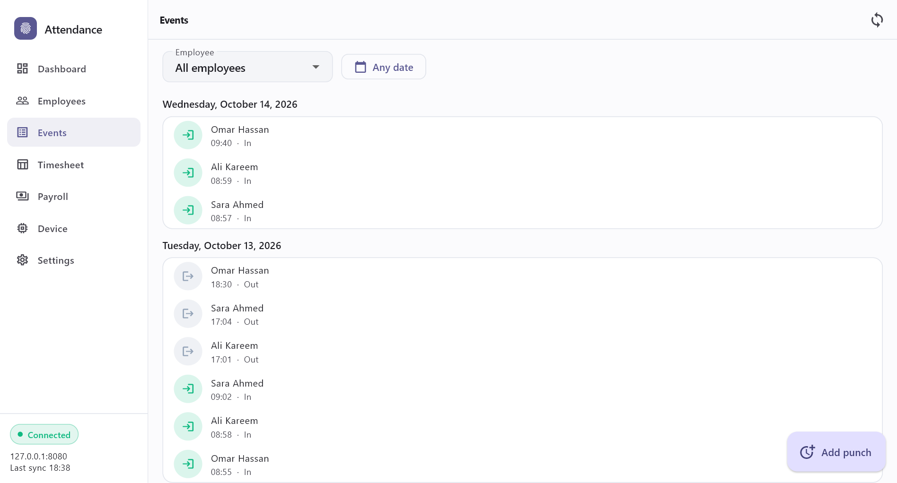<br><b>Punches</b>: every check-in and check-out, with corrections</td>
<td align="center">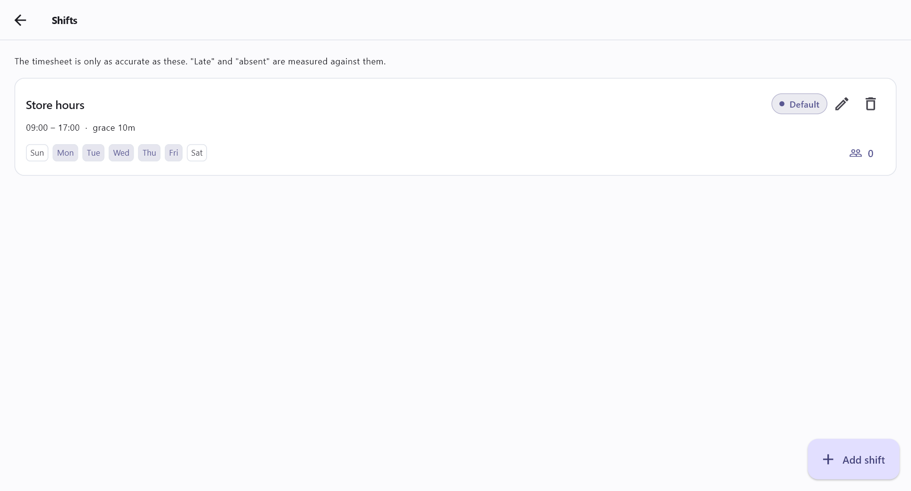<br><b>Shifts</b>: working hours, grace periods and days off</td>
</tr>
<tr>
<td align="center"><br><b>Timesheet</b>: late, early, overtime and absence per person</td>
<td align="center"><br><b>Payroll</b>: monthly totals with deductions and overtime</td>
</tr>
<tr>
<td align="center">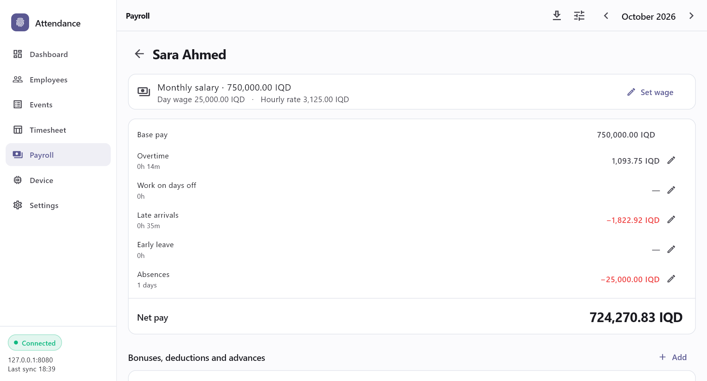<br><b>Payslip</b>: per-employee breakdown, exportable</td>
<td align="center">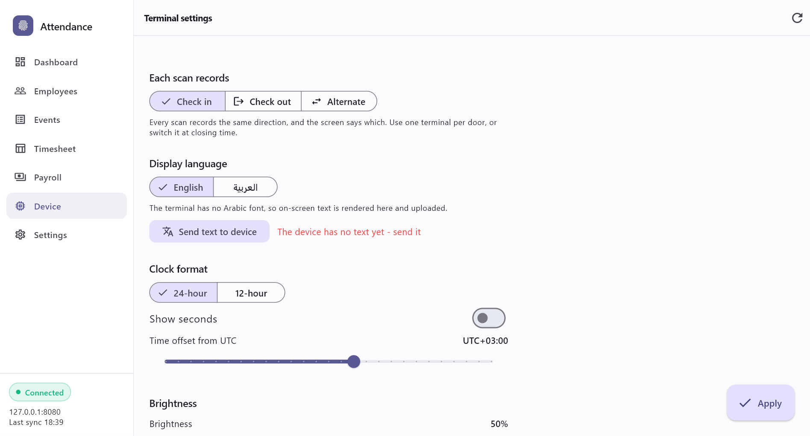<br><b>Device</b>: terminal health, mode and settings</td>
</tr>
<tr>
<td align="center">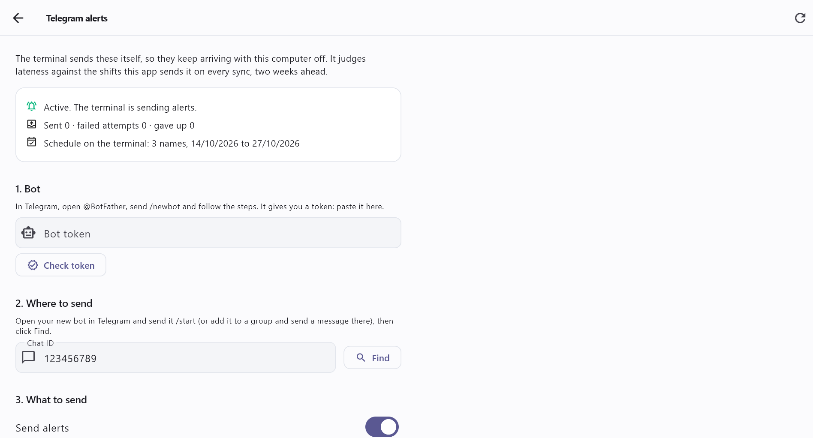<br><b>Telegram alerts</b>: set up the bot the terminal reports to</td>
<td align="center">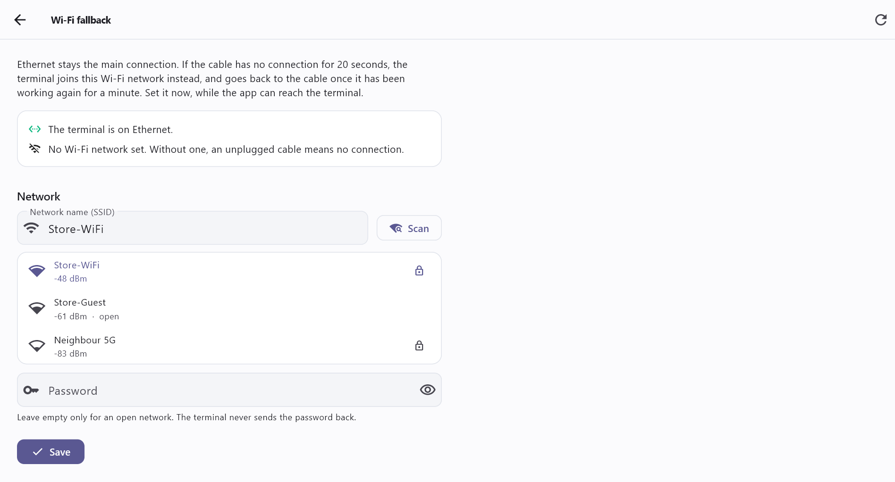<br><b>Wi-Fi fallback</b>: scan and join a network from the app</td>
</tr>
</table>

<details>
<summary><b>Arabic interface (right-to-left)</b></summary>
<br>
<table>
<tr>
<td align="center">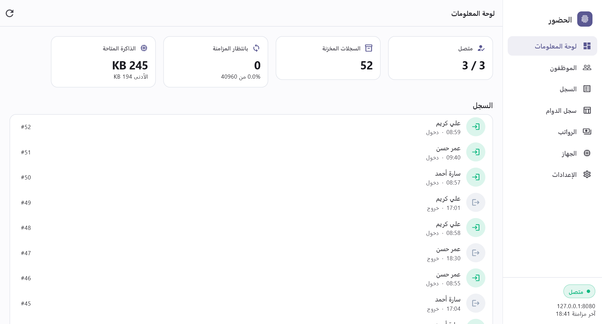<br>لوحة التحكم</td>
<td align="center">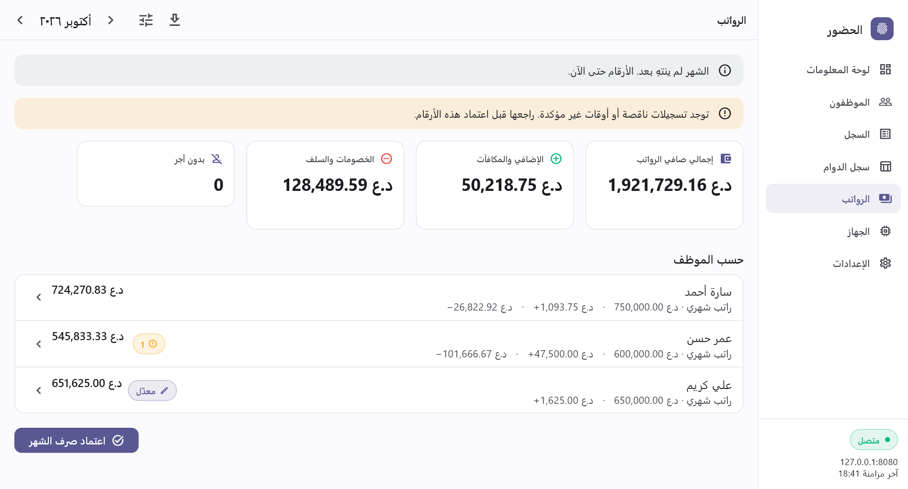<br>الرواتب</td>
</tr>
<tr>
<td align="center">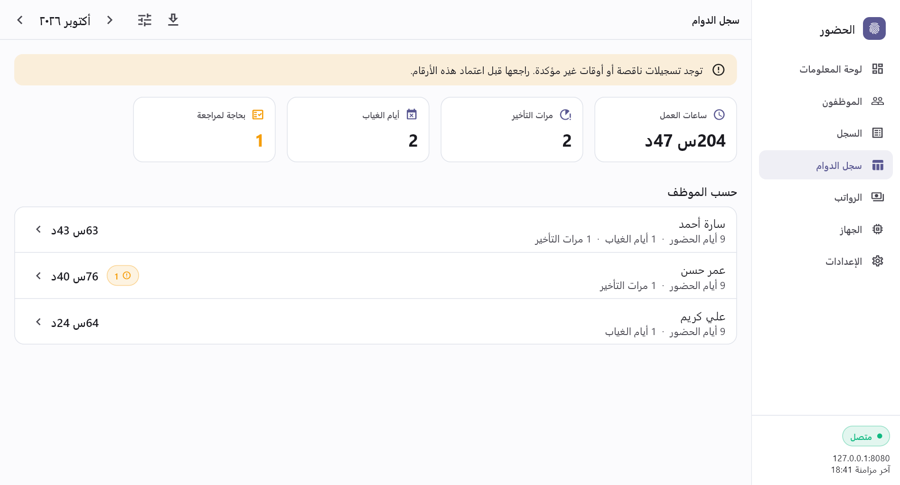<br>سجل الدوام</td>
<td align="center">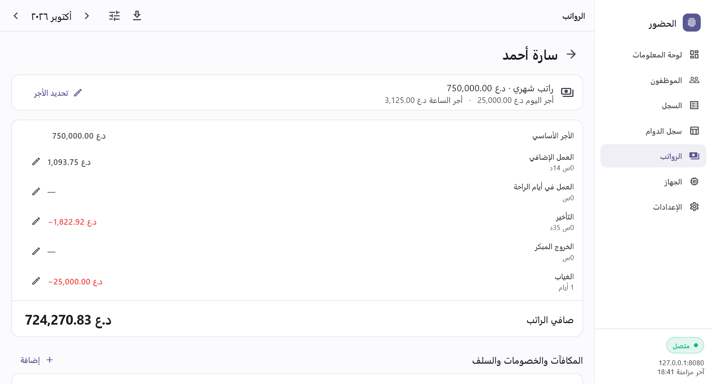<br>قسيمة الراتب</td>
</tr>
</table>
</details>

## Architecture

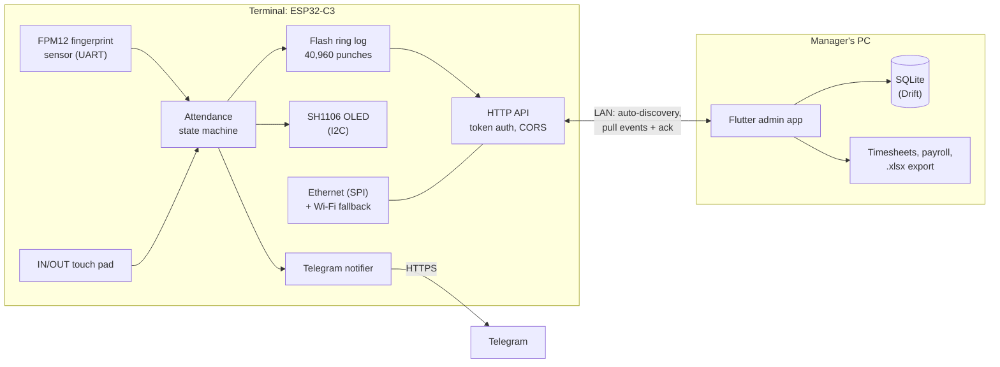

**Key design choices** (full reasoning in [docs/decisions.md](docs/decisions.md)):

- **The device records, the PC computes.** The terminal only stores raw punches; shifts, lateness and payroll are worked
  out in the app, so rules can change without reflashing.
- **Pull with acknowledgement.** The app asks for events after the last sequence number it has, then acknowledges them.
  Sequence numbers never repeat, even across a log erase, so sync can't lose or duplicate punches.
- **Arabic rendered on the PC.** The OLED has no Arabic font; the app shapes and rasterises each name and uploads it as a
  bitmap.
- **Ethernet first, Wi-Fi as backup.** Wi-Fi starts only after Ethernet has been down for 20 s and stops once the
  cable has been back for 60 s.

## Hardware

| Part | Notes |
|---|---|
| ESP32-C3 SuperMini (or ESP32-WROOM-32) | Board selected in `menuconfig` |
| FPM12 / R307-family optical fingerprint sensor | UART at 57600 baud, 5 V supply, 3.3 V logic, 1000 templates |
| SH1106 1.3" 128×64 I2C OLED | SSD1306 / SSD1309 / SSD1327 also supported |
| ENC28J60 or W5500 SPI Ethernet module | Wi-Fi takes over when the cable is unplugged |
| TTP223 touch pad (optional) | IN / OUT toggle |
| Buzzer and LED (optional) | Punch feedback |

Pin maps, the wiring harness and measured logic levels are in [docs/wiring.md](docs/wiring.md) and
[`firmware/main/Kconfig.projbuild`](firmware/main/Kconfig.projbuild).

## Getting started

### Firmware (ESP-IDF v6.1)

```powershell
cd firmware
idf.py set-target esp32c3
idf.py menuconfig          # board, pins, Ethernet chip, OLED driver
idf.py build flash monitor
```

On first boot the terminal prints its access token in the log (`generated new device token`). Enter it in the app
together with the terminal's address, or let the app find the terminal for you.

### Admin app (Flutter 3.47+)

Requires Visual Studio with the *Desktop development with C++* workload and Windows Developer Mode.

```powershell
cd app
flutter pub get
flutter run -d windows                # development
flutter build windows --release       # ship build\windows\x64\runner\Release\
flutter test                          # unit and widget tests
```

### No hardware? Use the mock terminal

```powershell
python tools/mock_terminal.py --host 127.0.0.1 --port 8080
```

It speaks the firmware's exact API. Connect the app to `127.0.0.1:8080` with token
`0123456789abcdef0123456789abcdef`.

## Device API

All requests need `Authorization: Bearer <device token>`. Full contract: [docs/protocol.md](docs/protocol.md).

| Area | Endpoints |
|---|---|
| Device | `GET /api/v1/info`, `GET /api/v1/health`, `POST /api/v1/time`, `POST /api/v1/config`, `POST /api/v1/reset` |
| Events | `GET /api/v1/events?since=&limit=`, `POST /api/v1/events/ack` |
| Users and enrolment | `GET/POST /api/v1/users`, `POST /api/v1/enroll/start`, `POST /api/v1/enroll/cancel` |
| Telegram | `GET/POST /api/v1/notify`, `POST /api/v1/notify/test`, `POST /api/v1/notify/summary`, `POST /api/v1/roster` |
| Wi-Fi | `GET/POST /api/v1/wifi`, `GET /api/v1/wifi/scan` |

## Testing

- **179 unit and widget tests** in the app: payroll, timesheets, sync, Arabic text shaping, device scanning, Excel export
- **End-to-end integration test** that drives the real Windows build through every page against the mock terminal
- Firmware verified on real hardware: enrolment, matching, flash log across power cycles, Ethernet, OLED, time sync

## Project structure

```
firmware/   ESP-IDF project in C: fingerprint, OLED, Ethernet/Wi-Fi, HTTP API, event log, Telegram
app/        Flutter admin app: Drift/SQLite database, timesheets, payroll, Excel export
tools/      Mock terminal, OLED screen simulator, PowerShell API helpers
docs/       Protocol, wiring, design decisions, toolchain notes, user guides (EN/AR)
```

## User guide

Step-by-step guides with screenshots for the shop manager:

- 📘 [English (PDF)](docs/User-Guide-EN.pdf)
- 📗 [العربية (PDF)](docs/User-Guide-AR.pdf)

## License

[PolyForm Noncommercial 1.0.0](LICENSE): free for personal, educational and other non-commercial use. Selling it, or
using it in a commercial product, needs permission from the author.

`firmware/components/enc28j60` is Espressif's driver under its own Apache-2.0 license.

---

<p align="center">Built by <a href="https://github.com/Muntazer2030">Muntazer Al-Mosawi</a> · Embedded and IoT engineer</p>
